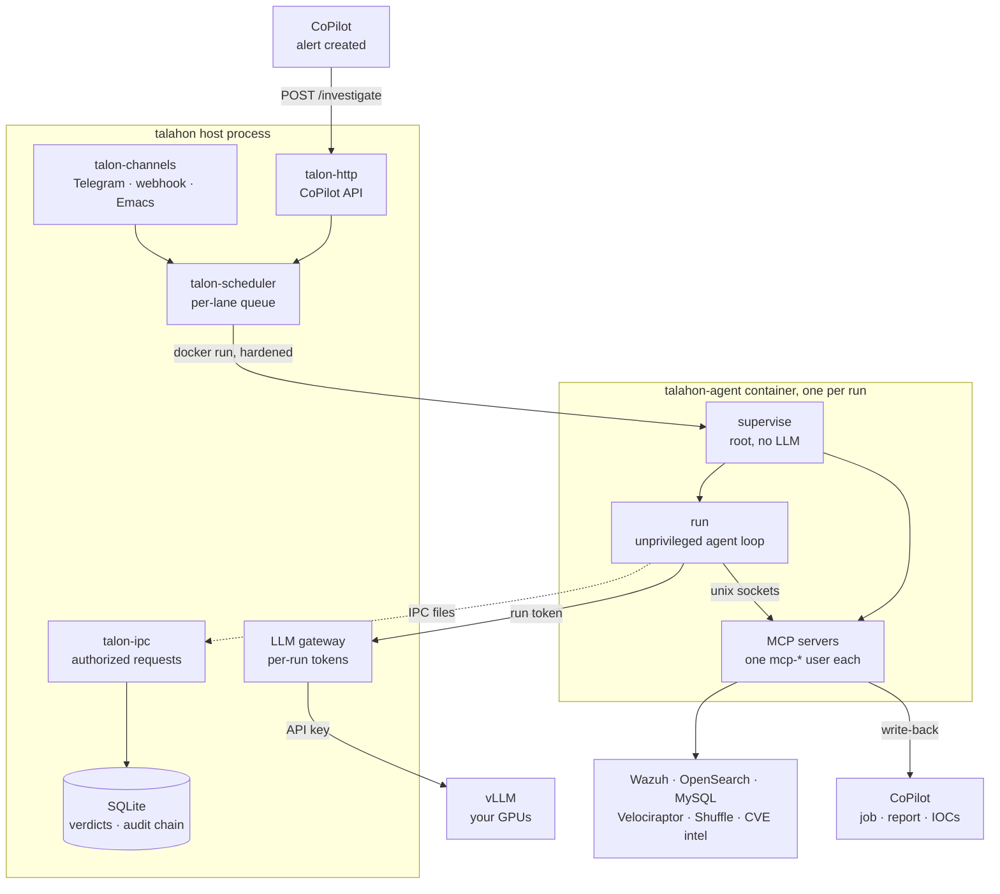
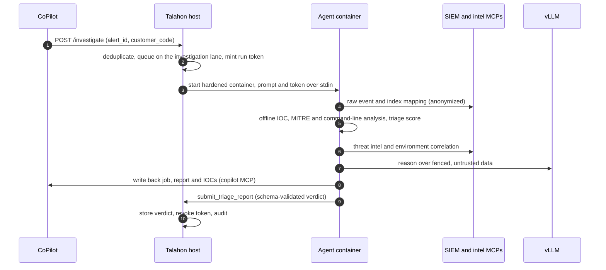

<div align="center">


# Talahon

**The self-hosted AI SOC analyst for the CoPilot SOC stack.**<br>
Written in Rust · powered by your own vLLM · built to survive hostile input.

[](https://github.com/Liohtml/talahon/actions/workflows/ci.yml)
[](https://crates.io/crates/talahon)
[](https://docs.rs/talahon)
[](https://www.rust-lang.org)
[](docs/PROVIDER_SELECTION.md)
[](Cargo.toml)
[](docs/MYTHOS_REVIEW.md)
[](LICENSE)

[Features](#-features) ·
[Architecture](#-architecture) ·
[Security](#-security) ·
[Quick start](#-quick-start) ·
[Deployment](#-deployment-guide) ·
[Operations](#-operations) ·
[Docs](#-documentation) ·
[Credits](#-credits)

</div>

---

Talahon runs next to [CoPilot](https://github.com/Liohtml/CoPilot) and
investigates every alert like a Tier 1/2 analyst: it pulls the raw event from
your Wazuh/OpenSearch SIEM, extracts and enriches indicators, maps them to
MITRE ATT&CK, correlates across your environment and writes a structured
verdict — severity, confidence, evidence and recommended actions — back into
CoPilot.

Talahon is written in **Rust** end to end. The model runs on **your own vLLM
server**, so SIEM data never leaves your infrastructure, and every layer
assumes that the data it reads was written by an attacker.

## ✨ Features

<table>
<tr>
<td width="33%" valign="top">

### 🔎 Autonomous investigations
Real-time `POST /investigate` from CoPilot plus a scheduled sweep as a safety
net, deduplicated per alert. Each run ends in a schema-validated verdict, not
free text.

</td>
<td width="33%" valign="top">

### 🧠 Self-hosted model
A native Rust agent loop talks to vLLM's OpenAI-compatible API: tool calling,
streaming, guided JSON decoding, prefix caching. No cloud LLM and no
third-party agent framework.

</td>
<td width="33%" valign="top">

### 🛡️ Hardened by design
Privilege-separated containers, per-run LLM tokens, prompt-injection
fencing, SSRF-safe egress, secret redaction and a hash-chained audit log.

</td>
</tr>
<tr>
<td valign="top">

### 🕵️ Privacy-preserving SIEM access
The anonymizing MCP proxy tokenizes users, hosts, internal IPs and domains,
SIDs, MACs and profile paths before results reach the model.

</td>
<td valign="top">

### 📊 Offline SOC intelligence
Deterministic engine: IOC extraction (16 types, defang-aware), 265-entry
ATT&CK mapping, LOLBin and obfuscation analysis with PowerShell decoding,
explainable 0–100 triage scoring.

</td>
<td valign="top">

### 🔁 CoPilot-native
Job status, report and enriched IOCs are written back through CoPilot's REST
API. Verdicts and IOC sightings stay local for cross-alert correlation.

</td>
</tr>
</table>

### At a glance

| | |
|---|---|
| Runtime | Rust workspace: `talahon` on the host, `talahon-agent` in the container |
| Model | **vLLM** on your own GPUs, or the **Anthropic Messages API** — both behind the authenticated host gateway |
| Model credentials | The key stays on the host; each run gets a short-lived token over stdin |
| Container | Root supervisor without LLM; MCP servers as separate `mcp-*` users; agent unprivileged |
| Untrusted data | Nonce-fenced envelopes plus an injection scanner (EN/DE) |
| Isolation | Per lane: every analyst, the investigation lane and the webhook lane are separate principals |
| Verdicts | `submit_triage_report` with JSON schema, stored and queryable via `GET /investigations` |
| Audit | Hash-chained audit table, HMAC-keyed with `TALAHON_AUDIT_KEY`; `talahon audit verify` |

## 🧩 Architecture



### How an investigation runs



<details>
<summary><b>Crate map</b></summary>

Each crate lives in `crates/talon-*` and is published on crates.io as
`talahon-*` (the `talon` names were taken); its Rust name stays `talon_*`.

| Crate (`crates/`) | crates.io | Responsibility |
|---|---|---|
| `talon` | [`talahon`](https://crates.io/crates/talahon) | Host binary: orchestrator, CLI (`run`, `setup`, `doctor`, `audit`) |
| `talon-core` | [`talahon-core`](https://crates.io/crates/talahon-core) | Shared types, host ↔ container protocol, traits, config, scheduling |
| `talahon-agent` | [`talahon-agent`](https://crates.io/crates/talahon-agent) | In-container runtime: root supervisor + unprivileged vLLM agent loop |
| `talon-llm` | [`talahon-llm`](https://crates.io/crates/talahon-llm) | vLLM client (streaming, tool-call recovery, guided decoding) + host gateway |
| `talon-mcp` | [`talahon-mcp`](https://crates.io/crates/talahon-mcp) | Native Model Context Protocol client, server and manager |
| `talon-tools` | [`talahon-tools`](https://crates.io/crates/talahon-tools) | Built-in agent tools with path guard and SSRF-safe `web_fetch` |
| `talon-intel` | [`talahon-intel`](https://crates.io/crates/talahon-intel) | IOC / MITRE / command-line / triage / correlation engine + report schema |
| `talon-anon` | [`talahon-anon`](https://crates.io/crates/talahon-anon) | PII anonymizer and `talahon-anon-proxy` |
| `talon-mcp-opensearch` | [`talahon-mcp-opensearch`](https://crates.io/crates/talahon-mcp-opensearch) | Native read-only OpenSearch MCP server `talahon-opensearch-mcp` (opt-in) |
| `talon-mcp-mysql` | [`talahon-mcp-mysql`](https://crates.io/crates/talahon-mcp-mysql) | Native MySQL MCP server `talahon-mysql-mcp` (opt-in) |
| `talon-security` | [`talahon-security`](https://crates.io/crates/talahon-security) | Injection guard, redaction, egress, mounts, senders, IPC authz, auth |
| `talon-container` | [`talahon-container`](https://crates.io/crates/talahon-container) | Hardened docker/podman launcher, mounts, output parser |
| `talon-net` | [`talahon-net`](https://crates.io/crates/talahon-net) | Hardened HTTP serving: header timeouts, connection caps |
| `talon-scheduler` | [`talahon-scheduler`](https://crates.io/crates/talahon-scheduler) | Group queue and task scheduler |
| `talon-ipc` | [`talahon-ipc`](https://crates.io/crates/talahon-ipc) | Host-side IPC watcher |
| `talon-http` | [`talahon-http`](https://crates.io/crates/talahon-http) | CoPilot HTTP API channel |
| `talon-channels` | [`talahon-channels`](https://crates.io/crates/talahon-channels) | Telegram, outbound webhook, Emacs bridge |
| `talon-router` | [`talahon-router`](https://crates.io/crates/talahon-router) | Message formatting and session lanes |
| `talon-db` | [`talahon-db`](https://crates.io/crates/talahon-db) | SQLite store: messages, tasks, sessions, verdicts, IOC sightings, audit chain |
| `talon-setup` | [`talahon-setup`](https://crates.io/crates/talahon-setup) | Setup, verification, egress firewall and service installation |

Design details: [docs/RUST_ARCHITECTURE.md](docs/RUST_ARCHITECTURE.md).

</details>

## 🔐 Security

Talahon treats every alert field, log line, web page and tool result as
attacker-controlled. Prompt injection can't be prevented, only contained, so
the design assumes a compromised agent in every lane and limits what it can
reach.

| Layer | Defence |
|---|---|
| Prompt injection | Untrusted data is wrapped in randomly nonced `<untrusted_data>` envelopes the model is told never to obey; a ~75-rule EN/DE scanner (normalization, base64/exfil decoders, tuned to stay quiet on real SIEM telemetry) flags and audits high-risk content |
| Model credentials | The vLLM key stays on the host gateway; each run gets a short-lived token (stored as SHA-256, revoked at the end) over stdin, never env. The gateway pins models, clamps tokens, forwards only allowlisted request fields, salts the prefix cache per lane, rate-limits per run and globally and caps the share of concurrency one lane may hold |
| Container | `--cap-drop=ALL` (+ minimal supervisor caps), `no-new-privileges`, read-only rootfs + tmpfs, `--init`, pid/memory/cpu limits, no sudo or node in the image; read-only `AGENT.md` (and legacy `CLAUDE.md`), `.mcp.json` and MCP dirs; mounts containing the project root, `store/`, `data/`, `groups/` or `.env` are refused; credential files in any mount are shadowed |
| Privilege separation | The root supervisor starts each MCP server as its own `mcp-*` user with a private HOME; the agent runs unprivileged and can't read MCP secrets or their process environments |
| Lane isolation | Every lane is its own principal: it can only message and schedule into itself, touch tasks it owns and never attach scripts; transcripts, reports and archives are per lane |
| Host ↔ container | Identity comes from the IPC directory, never from file contents; `openat`/`O_NOFOLLOW` file handling, size and depth limits, claim-before-dispatch, every decision audited |
| Network | Dedicated `talon-agents` bridge without inter-container traffic; `talahon setup egress` blocks metadata and link-local, exposes only the gateway port on the host and can allowlist MCP destinations |
| Egress | `web_fetch` and webhooks check every hop against all special IPv4/IPv6 ranges, pin DNS to vetted addresses and refuse redirects to internal hosts |
| HTTP API | Loopback by default, constant-time API key check, per-IP throttling, allowlist CORS, body limits, security headers; header-read timeouts and connection caps on every listener |
| Memory | MemPalace data belongs to `mcp-palace`; agents can neither read nor plant files there, and host `/palace/*` calls run in a one-shot locked-down container |
| Supply chain | Base images pinned by digest, every MCP server pinned to a commit SHA or exact version in [`container/mcp-versions.env`](container/mcp-versions.env), CI actions pinned by SHA; licenses, sources and banned crates enforced with `cargo deny`; the image is built and smoke-tested in CI |
| Secrets in output | Logs and outbound messages pass through a redactor (bearer/JWT/vendor keys/PEM/basic auth + every configured secret value) |
| Audit | Append-only SQLite audit log with a hash chain: SHA-256 by default, HMAC-SHA-256 once `TALAHON_AUDIT_KEY` is set, so a database writer without the key cannot forge or recompute rows; a keyed checkpoint file outside the database reveals a truncated tail. `talahon audit verify` checks all of it, `talahon audit head` exports the head for external anchoring ([limits](docs/SECURITY.md#7-audit)) |

The rewrite went through three rounds of adversarial review; findings, proofs
of concept, fixes and accepted residual risks are in
[docs/MYTHOS_REVIEW.md](docs/MYTHOS_REVIEW.md). Trust model and boundaries:
[docs/SECURITY.md](docs/SECURITY.md).

## 🚀 Quick start

```bash
git clone https://github.com/Liohtml/talahon.git /opt/talahon && cd /opt/talahon
cargo build --release && sudo install -m 0755 target/release/talahon /usr/local/bin/talahon
./container/build.sh                        # builds talahon-agent:latest
cp .env.example .env && chmod 600 .env      # set TALAHON_VLLM_* and HTTP_API_KEY
talahon setup vllm                            # checks that the models are served
talahon doctor                                # runtime, image, vLLM, gateway, instructions, audit chain
talahon run
```

The host binary is also on crates.io: `cargo install talahon --locked`
installs `talahon` (and, for this major version, the deprecated `talon` alias). The agent image, group folders and MCP wrappers still come
from the repository checkout.

The deployment guide below covers the mount allowlist, MCP credentials,
egress firewall and service installation, which a production setup needs.

## 📦 Deployment guide

### Prerequisites

- Linux host (macOS works for development) with Docker or Podman
- Rust 1.89+ (`rustup`) to build the host binary
- A **vLLM** server reachable from the host ([docs/PROVIDER_SELECTION.md](docs/PROVIDER_SELECTION.md))
- OpenSearch/Wazuh SIEM and a [CoPilot](https://github.com/Liohtml/CoPilot) instance with its MySQL/MariaDB database

### 1. Build

```bash
git clone https://github.com/Liohtml/talahon.git /opt/talahon
cd /opt/talahon
cargo build --release
sudo install -m 0755 target/release/talahon /usr/local/bin/talahon
CONTAINER_RUNTIME=docker ./container/build.sh      # builds talahon-agent:latest
```

### 2. Start vLLM

```bash
vllm serve Qwen/Qwen3-32B --enable-auto-tool-choice --tool-call-parser hermes \
  --reasoning-parser qwen3 --enable-prefix-caching --max-model-len 131072 \
  --api-key "$(openssl rand -hex 32)"
```

Model and parser choices per family are in
[docs/PROVIDER_SELECTION.md](docs/PROVIDER_SELECTION.md).

> [!IMPORTANT]
> Always run vLLM with `--api-key`. The host gateway refuses to start without
> `TALAHON_VLLM_API_KEY` (override only with `TALAHON_VLLM_ALLOW_NO_API_KEY=true`),
> because containers could otherwise call an unauthenticated vLLM directly and
> bypass the gateway.

### 3. Create `.env`

```bash
cp .env.example .env && chmod 600 .env
# Set at least: TALAHON_VLLM_BASE_URL, TALAHON_VLLM_MODEL, TALAHON_VLLM_MAX_CONTEXT,
#               TALAHON_VLLM_API_KEY, HTTP_API_KEY
talahon setup vllm
```

### 4. Create the mount allowlist

The allowlist controls which host directories may be mounted into agent
containers. It lives outside the project root in `~/.config/talahon/`, so
agents can't modify it.
Without it, no additional mounts are allowed.

> [!WARNING]
> List each directory explicitly — never allowlist the project root or a
> parent of it. Talahon refuses mounts that contain the project root, `store/`,
> `data/`, `groups/` or `.env`, and shadows secret files in every allowed
> mount.

<details>
<summary><b>Generate the allowlist</b></summary>

```bash
mkdir -p ~/.config/talahon && chmod 700 ~/.config/talahon
T=$(pwd)
ro() { printf '    { "path": "%s/%s", "allowReadWrite": false },\n' "$T" "$1"; }
{
  echo '{ "allowedRoots": ['
  for d in siem mysql copilot-mcp wazuh-mcp velociraptor-mcp shuffle-mcp cve-mcp mempalace; do ro "$d"; done
  printf '    { "path": "%s/mempalace-data", "allowReadWrite": true,\n      "description": "MemPalace data, owned by mcp-palace inside containers" }\n' "$T"
  echo '  ],'
  echo '  "blockedPatterns": [],'
  echo '  "nonMainReadOnly": false'
  echo '}'
} > ~/.config/talahon/mount-allowlist.json
chmod 600 ~/.config/talahon/mount-allowlist.json
```

</details>

MCP directories are always mounted read-only, whatever the allowlist says, and
their `.env` and credential files are shadowed and staged for their `mcp-*`
user only. `nonMainReadOnly` is `false` only so that `mempalace-data` can stay
writable. Inside the container it belongs to `mcp-palace` (mode 0700), so the
agent can neither read nor modify it. Host-side `/palace/*` calls run as
`mcp-palace` (uid 61008) in a one-shot container, so hand the directory over
once before the first start and back it up with `sudo`:

```bash
mkdir -p mempalace-data && sudo chown -R 61008:61008 mempalace-data && sudo chmod 700 mempalace-data
```

### 5. Configure the MCP servers

Each MCP server keeps its credentials in its own directory. Inside the
container they are readable only by that server's user.

| Directory | Setup | Credentials |
|---|---|---|
| `siem/` | `bash siem/setup.sh` | `OPENSEARCH_HOSTS`, `OPENSEARCH_USERNAME`, `OPENSEARCH_PASSWORD`; optional `TALAHON_OPENSEARCH_MCP=rust` |
| `mysql/` | `bash mysql/setup.sh` | `MYSQL_HOST`, `MYSQL_PORT`, `MYSQL_USER`, `MYSQL_PASS`, `MYSQL_DB`; optional `TALAHON_MYSQL_MCP=rust` |
| `copilot-mcp/` | `bash copilot-mcp/setup.sh` | `COPILOT_URL`, `COPILOT_USERNAME`, `COPILOT_PASSWORD` |
| `wazuh-mcp/` | `bash wazuh-mcp/setup.sh` | `WAZUH_PROD_URL`, `WAZUH_PROD_USERNAME`, `WAZUH_PROD_PASSWORD` |
| `velociraptor-mcp/` | `bash velociraptor-mcp/setup.sh` + `api.config.yaml` | Velociraptor API client config |
| `shuffle-mcp/` *(optional)* | `bash shuffle-mcp/setup.sh` | `SHUFFLE_URL`, `SHUFFLE_API_KEY` |
| `cve-mcp/` *(optional)* | `bash cve-mcp/setup.sh` | `NVD_API_KEY`, optional VirusTotal/Shodan/AbuseIPDB/GreyNoise/urlscan keys |
| `mempalace/` *(optional)* | `bash mempalace/setup.sh` | — (local ChromaDB + SQLite in `mempalace-data/`) |

The versions of all MCP servers are pinned in
[`container/mcp-versions.env`](container/mcp-versions.env), for the image and
for the `setup.sh` scripts alike. To update one, review the upstream diff,
change the pin and rebuild the image.

`TALAHON_OPENSEARCH_MCP=rust` in `siem/.env` (opt-in) serves the SIEM tools from
the native `talahon-opensearch-mcp` binary (read-only, no Python cold start)
instead of the Python `opensearch-mcp-server`, which stays the default.

`TALAHON_MYSQL_MCP=rust` in `mysql/.env` (opt-in) serves the MySQL tools
(`execute_sql`, `get_schema_info`, `get_table_sample`) from the native
`talahon-mysql-mcp` binary instead of the Python `mysql-mcp-server`, which stays
the default: same arguments and result text, no Python cold start, and bounded
statements (connect and query timeouts, row and byte limits). Like the Python
server it runs any single statement the database account may run, so what the
agent can change is decided by that account's grants. TLS follows
`MYSQL_SSL_MODE` (see [`mysql/.env.example`](mysql/.env.example)).

Services on the Talahon host are reachable from containers as
`host.docker.internal`. Which servers a group uses, and as which user, is
defined in `groups/<group>/.mcp.json` (`"runAs": "mcp-siem"` etc.).

### 6. Restrict container egress (Linux)

Agent containers run on the dedicated `talon-agents` bridge (`br-talon`,
inter-container traffic disabled). The firewall rules always block cloud
metadata and link-local addresses, let containers reach the host only on the
LLM gateway port and, in allowlist mode, only the destinations your MCP
servers need:

```bash
talahon setup egress --allow 10.0.0.10:9200 --allow 10.0.0.11:3306 \
                   --allow 10.0.0.12:55000 --allow 10.0.0.13:443   # SIEM, MySQL, Wazuh, CoPilot ...
# review the printed nft/iptables script, then:
sudo talahon setup egress --apply --allow ...                          # same arguments
```

Without `--allow` the rules block private address ranges and keep internet
egress (`--keep-internet` combines both).

> [!NOTE]
> The rules don't survive a reboot on their own. Add `--persist` to the
> `--apply` call (systemd hosts): it installs `talahon-egress.service`, which
> re-applies the same rules at every boot. `--uninstall --apply` removes it.

### 7. Register groups and install the service

```bash
talahon setup environment                 # runtime, image, vLLM, gateway, disk
talahon setup register --jid http:copilot --name CoPilot --folder copilot \
  --trigger @Talahon --no-trigger-required
talahon setup service                     # systemd user unit (hardened) or launchd plist
talahon doctor                            # everything in one report
```

Manual alternative: `systemctl --user enable --now talahon` with
`ExecStart=/usr/local/bin/talahon run` and `WorkingDirectory=/opt/talahon`, or
`launchd/com.talahon.plist` on macOS.

### 8. Verify

```bash
curl http://localhost:3100/health                          # unauthenticated
export TALAHON_API_KEY=...                                    # HTTP_API_KEY from .env
curl -s -N -X POST http://localhost:3100/message \
  -H "Content-Type: application/json" -H "x-api-key: $TALAHON_API_KEY" \
  -d '{"message": "Check SIEM cluster health", "sender": "test"}'
curl -s -H "x-api-key: $TALAHON_API_KEY" http://localhost:3100/status
talahon audit tail -n 20
```

The API binds `127.0.0.1` by default. Set `COPILOT_HTTP_BIND` to a private
interface if CoPilot runs on another host, and terminate TLS in front of it.

## 🧰 Operations

| Command | Purpose |
|---|---|
| `talahon run` | Run the service (default) |
| `talahon doctor` | Diagnose runtime, image, vLLM, gateway, directories, audit chain |
| `talahon setup <step>` | `timezone`, `environment`, `vllm`, `container`, `groups`, `register`, `mounts`, `egress`, `service`, `verify` |
| `talahon audit verify` | Verify the audit chain, its MACs and the truncation checkpoint (exit code 1 on tampering) |
| `talahon audit head` | Print the newest row's id, hash and sequence number, for anchoring off-host |
| `talahon audit tail -n 50 --kind ipc.` | Recent audit events as JSON lines |
| `talahon eval score --reports <dir>` | Score saved verdicts against the golden set (offline) |
| `talahon eval run` | Investigate every golden case through a running Talahon, then score |

Logs: `RUST_LOG=info` (JSON with `TALAHON_LOG_FORMAT=json`); every line passes
through the redactor.

### Investigation quality (`talahon eval`)

[`evals/golden/`](evals/golden/README.md) holds synthetic alerts with a known
expected outcome: verdict, severity range, indicators and ATT&CK techniques
that must be reported, and content that must not appear (invented
indicators, leaked anonymization tokens such as `USER_1`). Run it before and
after a prompt, model or provider change.

```bash
# Offline: <dir>/<case id>.json is a verdict (TriageReport) or a
# GET /investigations/{id} record.
talahon eval score --reports <dir> [--json] [--min-pass-rate 0.85]

# Online: POST /investigate per case on a running Talahon, wait, score.
talahon eval run --alert-map map.json --save-dir out/ [--url http://127.0.0.1:3100]
```

Both print a per-case table, the failed checks and a verdict confusion
matrix (`--json` for the same as JSON), and exit `1` when the share of
passing cases is below `--min-pass-rate` (default `1.0`), `2` on unusable
input. `run` needs the cases' alerts seeded in the CoPilot stack the
instance is connected to and performs real investigations with all their
write-backs, so point it at a dedicated eval instance with
`COPILOT_INVESTIGATION_DEDUP_MINUTES=0`; see the golden-set README.

### HTTP API

All endpoints except `/health` require `X-Api-Key` or `Authorization: Bearer`.

| Endpoint | Purpose |
|---|---|
| `POST /investigate` | `{alert_id, customer_code, triggered_by?, template_override?}` → queued investigation, deduplicated per alert; `triggered_by` is `manual`, `scheduled` or `webhook` (default) |
| `GET /investigations`, `GET /investigations/{id}` | Investigation status and structured verdicts |
| `POST /message` | Analyst chat (SSE stream), per-user lanes via `user_id` |
| `POST /session/reset` | `{scope, user_id?}` with scope `chat`, `investigate` or `all` |
| `GET /status`, `GET /metrics` | Queue, lanes, sessions, tasks; Prometheus metrics |
| `GET /templates`, `GET /evals/{alert_id}` | Investigation templates and eval records |
| `POST /palace/lesson`, `GET /palace/search`, `POST /palace/forget` | MemPalace memory |

### Per-deployment configuration

| File | Purpose |
|---|---|
| `.env` | vLLM, gateway, HTTP API key, channels — `chmod 600`, gitignored |
| `<mcp-dir>/.env` | Per-MCP credentials — gitignored |
| `groups/copilot/AGENT.md` | SOC agent identity and investigation workflow (read-only inside containers); add client context such as assets, known-good ranges and crown jewels at the bottom |
| `groups/<group>/MEMORY.md` | The group's own agent-written notes (shown to the agent as untrusted data) |
| `groups/copilot/.mcp.json` | MCP servers and their `runAs` users (mounted read-only) |
| `groups/copilot/prompts/` | Per-alert-type investigation templates — add `.txt` files, no code changes |
| `siem/anon_proxy/fields.yaml` | PII field definitions for the anonymizing proxy |
| `~/.config/talahon/mount-allowlist.json` | Mount policy — outside the repo, tamper-proof |
| `~/.config/talahon/sender-allowlist.json` | Optional per-chat sender allowlist (`TALAHON_SENDER_ALLOWLIST_REQUIRED=true` to fail closed) |
| `mempalace-data/` | MemPalace data — back it up separately |

#### Upgrading: `CLAUDE.md` is now `AGENT.md`

A group's instructions (`groups/<folder>/AGENT.md`) were called `CLAUDE.md`
in Talahon 2.x. Existing installations keep working unchanged:

- Per folder, `AGENT.md` is used when it has content; otherwise an existing
  `CLAUDE.md` is used (and shown to the agent as `/workspace/group/AGENT.md`);
  a folder with neither gets a placeholder `AGENT.md`. The same applies to
  `groups/global/` and to the notes in extra mounts (`siem/AGENT.md`,
  `mysql/AGENT.md`).
- Migrate whenever convenient, one folder at a time (no restart needed, the
  next run picks it up):

  ```bash
  mv groups/<folder>/CLAUDE.md groups/<folder>/AGENT.md       # untracked folders
  git mv -f groups/<folder>/CLAUDE.md groups/<folder>/AGENT.md  # folders tracked in git
  ```

  `talahon doctor` lists the folders that still use `CLAUDE.md`
  (`CHECK_INSTRUCTIONS`, `LEGACY`).
- Both names are read-only inside every container, so after the first run
  each folder contains both files on the host: the one in use, and a one-line
  stub (an HTML comment starting with `<!-- Talahon mount point`) under the
  other name. The stub is never read as instructions and may be overwritten
  by the `mv` above. Do not delete either file while a container of that
  folder is running: removing a mount point on the host frees the name
  inside the running container (stop Talahon first; a missing stub is
  recreated on the next run).
- If both files of a group folder have content, Talahon does not pick one:
  every run in that folder is refused (`mount.rejected` in the audit log, the
  error names the folder) and `talahon doctor` fails with
  `instructions_conflict`. Older versions did not protect the name
  `AGENT.md`, so one that appears next to your `CLAUDE.md` may have been
  written by an agent, and it would otherwise become the trusted system
  prompt. If a launch is refused because both files exist, inspect both,
  keep the one you wrote and delete the other (rename a kept `CLAUDE.md` to
  `AGENT.md`). You can check before upgrading with `ls groups/*/AGENT.md`.
- The host and the agent image must be upgraded together
  (`./container/build.sh`): a new image refuses to run under an older host,
  because that host does not bind `AGENT.md` read-only.

## 🔧 Development

```bash
cargo build --workspace
cargo test --workspace                                   # 2,100+ tests
cargo clippy --workspace --all-targets -- -D warnings
cargo fmt --all --check
./container/build.sh                                     # agent image
```

Codebase rules: no `unsafe`, no `unwrap`/`expect` outside tests, untrusted data
fenced with `talon_security::injection::fence_untrusted`, security decisions
audited via `talon_core::audit`. See [CONTRIBUTING.md](CONTRIBUTING.md).

### Releases

Every merge to `main` that passes CI and changes a crate is released
automatically ([`release.yml`](.github/workflows/release.yml)): the next
version follows [Conventional Commits](https://www.conventionalcommits.org)
(`feat` → minor, `type!:` / `BREAKING CHANGE:` → major, anything else → patch),
`CHANGELOG.md` gets the entry, `main` gets a `chore(release)` commit and a
`vX.Y.Z` tag, GitHub gets a release, and all `talahon-*` crates are published
to crates.io with the same version.

## 📚 Documentation

| Document | Contents |
|---|---|
| [docs/RUST_ARCHITECTURE.md](docs/RUST_ARCHITECTURE.md) | Architecture, crate map, security contracts |
| [docs/SECURITY.md](docs/SECURITY.md) | Trust model, boundaries, residual risks, reporting |
| [docs/MYTHOS_REVIEW.md](docs/MYTHOS_REVIEW.md) | Adversarial security review: findings and fixes |
| [docs/PROVIDER_SELECTION.md](docs/PROVIDER_SELECTION.md) | vLLM setup, model and parser choice, gateway settings |
| [docs/COPILOT_INTEGRATION.md](docs/COPILOT_INTEGRATION.md) | CoPilot integration, MySQL schema, MCP tool reference |
| [docs/ANON_PROXY.md](docs/ANON_PROXY.md) | Anonymizing proxy: flow, token types, `fields.yaml` |
| [groups/copilot/prompts/README.md](groups/copilot/prompts/README.md) | Writing investigation templates |
| [CHANGELOG.md](CHANGELOG.md) | Release notes |

## ⬆️ Upgrading from Talon 2.x

Up to 2.x this project called itself **Talon**, while its crates.io packages
and its repository were already named `talahon` (the `talon` names belong to
someone else). With this major release the user-facing surface is **Talahon** throughout.
An existing installation keeps running after the upgrade: every old name
below is still accepted as an alias **for this major version and is removed
in the next one**.

| What | Old name | New name | Old name still works |
|---|---|---|---|
| Host binary | `talon` | `talahon` | yes: `talon` is still built and installed; it prints a one-line deprecation notice on stderr (not for `version` / `--help`; as a JSON log record with `TALAHON_LOG_FORMAT=json`) |
| Binaries in the agent image | `talon-agent`, `talon-anon-proxy`, `talon-opensearch-mcp`, `talon-mysql-mcp`, `talon-entrypoint` | `talahon-agent`, `talahon-anon-proxy`, `talahon-opensearch-mcp`, `talahon-mysql-mcp`, `talahon-entrypoint` | yes: symlinks in `/usr/local/bin`; the wrapper scripts look for both |
| Settings (`.env`, environment) | `TALON_*` | `TALAHON_*` | yes: the new name is read first, then the old one; if both are set the new one wins. One deprecation warning per key and process; `talahon doctor` lists them (`CHECK_RENAME`) |
| systemd unit / launchd agent | `talon.service`, `com.talon` | `talahon.service`, `com.talahon` | `talahon setup service` stops, disables and removes the old one, then installs the new one; `setup verify` recognises both |
| Egress boot unit | `talon-egress.service` | `talahon-egress.service` | `talahon setup egress --apply --persist` replaces the old unit; `--uninstall --apply` removes both |
| Wrapper without systemd | `start-talon.sh`, `talon.pid` | `start-talahon.sh`, `talahon.pid` | the new wrapper stops an instance recorded in `talon.pid`; `setup service` deletes `start-talon.sh` |
| Service log files | `logs/talon.log`, `logs/talon.error.log` | `logs/talahon.log`, `logs/talahon.error.log` | the old files are left in place and no longer written |
| Agent image | `talon-agent:latest` | `talahon-agent:latest` | not run silently: `talahon doctor` reports `image_has_old_name` until you rebuild (or set `CONTAINER_IMAGE=talon-agent:latest` on purpose) |
| Configuration directory | `~/.config/talon` | `~/.config/talahon` | yes: used when `~/.config/talahon` does not exist. Exactly one directory is authoritative, the two are never merged; `talahon doctor` says which |
| Assistant name (default) | `Talon` | `Talahon` | while `ASSISTANT_NAME` is not set, default triggers accept `@Talahon` and `@Talon`. With `ASSISTANT_NAME` set nothing changes (`ASSISTANT_NAME=Talon` keeps the old persona) |

**Intentionally unchanged** (internal identifiers; renaming them would break
running installations or the CoPilot side without any benefit to operators):

- Rust crate names and directories (`talon_core`, `crates/talon-*`) and the
  `talahon-*` package names.
- The Docker network `talon-agents`, its bridge `br-talon`, the nftables
  table `talon_egress`, the iptables chains `TALON-EGRESS` / `TALON-INPUT`,
  the rule comments and the container names and labels (`talon-<group>-…`,
  `talon.managed`). Agent containers of an upgraded host therefore stay on
  the network the installed firewall rules cover.
- Paths inside the container (`/run/talon`, `/home/agent/.talon`,
  `/workspace/...`), the IPC layout, `store/`, `data/`, database and
  checkpoint file names.
- Wire formats: the stdout frame markers (`---TALON_OUTPUT_START---`), the
  setup status blocks (`=== TALON SETUP: … ===`), fence tags and
  `[talon-guard]`, the audit HMAC domain and event kinds (`talon.start`),
  gateway token and cache-salt derivation.
- Prometheus metric names (`talon_*`), the HTTP API (paths,   `x-talon-signature`, JSON fields) and tool names.
- `emacs/talon.el` and its symbols.

**Migration checklist**

1. Build and install the new host binary (`cargo install talahon --locked`
   or `cargo build --release`), and rebuild the agent image:
   `./container/build.sh` (now tags `talahon-agent:latest`).
2. Re-run `talahon setup service` (replaces `talon.service` / `com.talon`)
   and, if you use the egress firewall,
   `sudo talahon setup egress --apply --persist ...` with your `--allow`
   arguments (replaces `talon-egress.service`; the rules themselves are
   unchanged).
3. Run `talahon doctor` and check `CHECK_RENAME`.
4. At leisure, before the next major version: rename the `TALON_*` keys in
   `.env` (and in `siem/.env`, `mysql/.env`) to `TALAHON_*`, move
   `~/.config/talon` to `~/.config/talahon`, and replace `talon` with
   `talahon` in your own scripts and cron jobs.

The assistant's name: the old `.env.example` set `ASSISTANT_NAME=Talon`. If
your `.env` still has that line, the assistant keeps the name Talon and
answers to `@Talon` only, exactly as before; remove the line (or set the
name you want) to switch.

Group instruction files you wrote are not touched by the upgrade. If
`ASSISTANT_NAME` is not set, `talahon setup register` updates the shipped
persona line (`# Talon` / `You are Talon`) to the current name the next time
you run it.

## 🙏 Credits

Talahon is an independent Rust rewrite, but it stands on the work of others:

- **[Talon](https://github.com/taylorwalton/talon)** by [SOCFortress](https://www.socfortress.co) (Taylor Walton) — the original AI SOC analyst for CoPilot (no longer maintained). Its investigation workflow, alert-type prompt templates, MCP server wrappers, anonymizing proxy and MemPalace integration are the foundation of this project.
- **[NanoClaw](https://github.com/qwibitai/nanoclaw)** and its contributors — the container-isolated agent framework the original Talon was built on: per-group lanes, IPC, scheduled tasks and group memory.
- **[CoPilot](https://github.com/socfortress/CoPilot)** by SOCFortress — the SOC platform Talahon works for, continued in Rust at [Liohtml/CoPilot](https://github.com/Liohtml/CoPilot).
- **MCP servers** Talahon's agent uses: SOCFortress' [copilot](https://github.com/socfortress/copilot-mcp-server), [Wazuh](https://github.com/socfortress/wazuh-mcp-server), [Velociraptor](https://github.com/socfortress/velociraptor-mcp-server) and [Shuffle](https://github.com/socfortress/shuffle-mcp-server) servers, [cve-mcp-server](https://github.com/mukul975/cve-mcp-server), [opensearch-mcp-server](https://pypi.org/project/opensearch-mcp-server/), [mysql-mcp-server](https://pypi.org/project/mysql-mcp-server/) and [MemPalace](https://pypi.org/project/mempalace/).
- **[vLLM](https://github.com/vllm-project/vllm)**, **[Wazuh](https://wazuh.com)**, **[OpenSearch](https://opensearch.org)** and **[Velociraptor](https://docs.velociraptor.app)**, which do the heavy lifting underneath.

### What the rewrite changed

The original Talon is a Node.js/TypeScript fork of NanoClaw that drives the
Claude Agent SDK; its repository is no longer maintained. Talahon keeps its
investigation workflow and replaces the runtime:

| | Original Talon | Talahon |
|---|---|---|
| Runtime | Node.js host, Claude Agent SDK in the container | One Rust workspace: host, in-container agent loop, LLM gateway, anonymizer |
| Model | Claude by default, Ollama through the SDK | vLLM on your own GPUs by default, Anthropic optional — always behind the host gateway |
| Model credentials | Credential proxy, with an env-var fallback into the container | Key never leaves the host; a per-run token over stdin |
| Anonymizing proxy | Python | Rust, with more PII coverage (lists, nested and dotted fields, free text) |

New in the rewrite: privilege separation inside the container (root supervisor
without LLM, every MCP server as its own user), per-lane isolation, the
deterministic IOC / ATT&CK / triage engine with schema-validated verdicts, the
hash-chained audit log, and three rounds of adversarial review.

## 📄 License

Released under the [MIT License](LICENSE).
