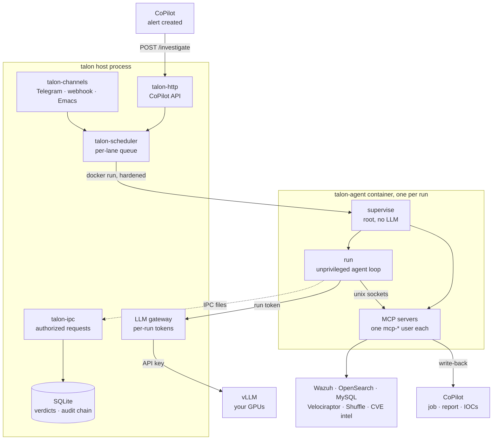
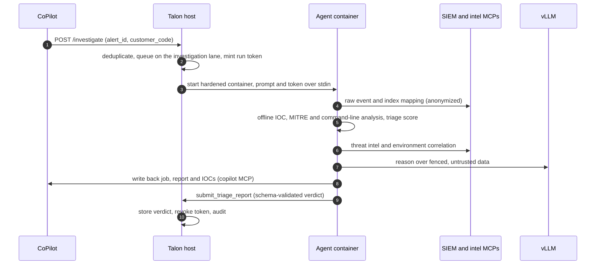

<div align="center">


# Talon

**The self-hosted AI SOC analyst for the SOCFortress CoPilot stack.**<br>
Written in Rust · powered by your own vLLM · built to survive hostile input.

[](https://github.com/Liohtml/talahon/actions/workflows/ci.yml)
[](https://www.rust-lang.org)
[](docs/PROVIDER_SELECTION.md)
[](Cargo.toml)
[](docs/MYTHOS_REVIEW.md)
[](LICENSE)

[Features](#-features) ·
[Architecture](#-architecture) ·
[Security](#-security) ·
[Quick start](#-quick-start) ·
[Deployment](#-deployment-guide) ·
[Operations](#-operations) ·
[Docs](#-documentation)

</div>

---

Talon runs next to [CoPilot](https://github.com/socfortress/CoPilot) and
investigates every alert like a Tier 1/2 analyst: it pulls the raw event from
your Wazuh/OpenSearch SIEM, extracts and enriches indicators, maps them to
MITRE ATT&CK, correlates across your environment and writes a structured
verdict — severity, confidence, evidence and recommended actions — back into
CoPilot.

**Talon 2.0** is a ground-up rewrite in **Rust**. The model runs on **your own
vLLM server**, so SIEM data never leaves your infrastructure, and every layer
assumes that the data it reads was written by an attacker.

## ✨ Features

<table>
<tr>
<td width="33%" valign="top">

### 🔎 Autonomous investigations
Real-time `POST /investigate` from CoPilot plus a scheduled sweep as a safety
net, deduplicated per alert. Each run ends in a schema-validated verdict, not
free text.

</td>
<td width="33%" valign="top">

### 🧠 Self-hosted model
A native Rust agent loop talks to vLLM's OpenAI-compatible API: tool calling,
streaming, guided JSON decoding, prefix caching. No cloud LLM, no Node.js,
no SDK.

</td>
<td width="33%" valign="top">

### 🛡️ Hardened by design
Privilege-separated containers, per-run LLM tokens, prompt-injection
fencing, SSRF-safe egress, secret redaction and a hash-chained audit log.

</td>
</tr>
<tr>
<td valign="top">

### 🕵️ Privacy-preserving SIEM access
The anonymizing MCP proxy tokenizes users, hosts, internal IPs and domains,
SIDs, MACs and profile paths before results reach the model.

</td>
<td valign="top">

### 📊 Offline SOC intelligence
Deterministic engine: IOC extraction (16 types, defang-aware), 265-entry
ATT&CK mapping, LOLBin and obfuscation analysis with PowerShell decoding,
explainable 0–100 triage scoring.

</td>
<td valign="top">

### 🔁 CoPilot-native
Job status, report and enriched IOCs are written back through CoPilot's REST
API. Verdicts and IOC sightings stay local for cross-alert correlation.

</td>
</tr>
</table>

### What changed in 2.0

| | Talon 1.x | Talon 2.0 |
|---|---|---|
| Runtime | Node.js + Claude Agent SDK | Rust workspace (`talon` host, `talon-agent` in the container) |
| Model | Anthropic API / Ollama | **vLLM** on your own GPUs, behind an authenticated host gateway |
| Model credentials | API key in the container | Key stays on the host; each run gets a short-lived token over stdin |
| Container | Agent and MCP servers in one context | Root supervisor without LLM; MCP servers as separate `mcp-*` users; agent unprivileged |
| Untrusted data | Passed to the model as is | Nonce-fenced envelopes plus an injection scanner (EN/DE) |
| Isolation | Per group | Per lane: every analyst, the investigation lane and the webhook lane are separate principals |
| Verdicts | Free-text reports | `submit_triage_report` with JSON schema, stored and queryable via `GET /investigations` |
| Audit | Log files | SHA-256 hash-chained audit table, `talon audit verify` |

## 🧩 Architecture



### How an investigation runs



<details>
<summary><b>Crate map</b></summary>

| Crate | Responsibility |
|---|---|
| `talon` | Host binary: orchestrator, CLI (`run`, `setup`, `doctor`, `audit`) |
| `talon-core` | Shared types, host ↔ container protocol, traits, config, scheduling |
| `talon-agent` | In-container runtime: root supervisor + unprivileged vLLM agent loop |
| `talon-llm` | vLLM client (streaming, tool-call recovery, guided decoding) + host gateway |
| `talon-mcp` | Native Model Context Protocol client, server and manager |
| `talon-tools` | Built-in agent tools with path guard and SSRF-safe `web_fetch` |
| `talon-intel` | IOC / MITRE / command-line / triage / correlation engine + report schema |
| `talon-anon` | PII anonymizer and `talon-anon-proxy` |
| `talon-security` | Injection guard, redaction, egress, mounts, senders, IPC authz, auth |
| `talon-container` | Hardened docker/podman launcher, mounts, output parser |
| `talon-net` | Hardened HTTP serving: header timeouts, connection caps |
| `talon-scheduler` | Group queue and task scheduler |
| `talon-ipc` | Host-side IPC watcher |
| `talon-http`, `talon-channels`, `talon-router` | Channels and message formatting |
| `talon-db` | SQLite store (migrates Talon 1.x databases in place) |
| `talon-setup` | Setup, verification, egress firewall and service installation |

Design details: [docs/RUST_ARCHITECTURE.md](docs/RUST_ARCHITECTURE.md).

</details>

## 🔐 Security

Talon treats every alert field, log line, web page and tool result as
attacker-controlled. Prompt injection can't be prevented, only contained, so
the design assumes a compromised agent in every lane and limits what it can
reach.

| Layer | Defence |
|---|---|
| Prompt injection | Untrusted data is wrapped in randomly nonced `<untrusted_data>` envelopes the model is told never to obey; a ~75-rule EN/DE scanner (normalization, base64/exfil decoders, tuned to stay quiet on real SIEM telemetry) flags and audits high-risk content |
| Model credentials | The vLLM key stays on the host gateway; each run gets a short-lived token (stored as SHA-256, revoked at the end) over stdin, never env. The gateway pins models, clamps tokens, forwards only allowlisted request fields, salts the prefix cache per lane and rate-limits per run and globally |
| Container | `--cap-drop=ALL` (+ minimal supervisor caps), `no-new-privileges`, read-only rootfs + tmpfs, `--init`, pid/memory/cpu limits, no sudo or node in the image; read-only `CLAUDE.md`, `.mcp.json` and MCP dirs; mounts containing the project root, `store/`, `data/`, `groups/` or `.env` are refused; credential files in any mount are shadowed |
| Privilege separation | The root supervisor starts each MCP server as its own `mcp-*` user with a private HOME; the agent runs unprivileged and can't read MCP secrets or their process environments |
| Lane isolation | Every lane is its own principal: it can only message and schedule into itself, touch tasks it owns and never attach scripts; transcripts, reports and archives are per lane |
| Host ↔ container | Identity comes from the IPC directory, never from file contents; `openat`/`O_NOFOLLOW` file handling, size and depth limits, claim-before-dispatch, every decision audited |
| Network | Dedicated `talon-agents` bridge without inter-container traffic; `talon setup egress` blocks metadata and link-local, exposes only the gateway port on the host and can allowlist MCP destinations |
| Egress | `web_fetch` and webhooks check every hop against all special IPv4/IPv6 ranges, pin DNS to vetted addresses and refuse redirects to internal hosts |
| HTTP API | Loopback by default, constant-time API key check, per-IP throttling, allowlist CORS, body limits, security headers; header-read timeouts and connection caps on every listener |
| Memory | MemPalace data belongs to `mcp-palace`; agents can neither read nor plant files there, and host `/palace/*` calls run in a one-shot locked-down container |
| Secrets in output | Logs and outbound messages pass through a redactor (bearer/JWT/vendor keys/PEM/basic auth + every configured secret value) |
| Audit | Append-only SQLite audit log with a SHA-256 hash chain; `talon audit verify` detects tampering |

The rewrite went through three rounds of adversarial review; findings, proofs
of concept, fixes and accepted residual risks are in
[docs/MYTHOS_REVIEW.md](docs/MYTHOS_REVIEW.md). Trust model and boundaries:
[docs/SECURITY.md](docs/SECURITY.md).

## 🚀 Quick start

```bash
git clone https://github.com/Liohtml/talahon.git /opt/talon && cd /opt/talon
cargo build --release && sudo install -m 0755 target/release/talon /usr/local/bin/talon
./container/build.sh                        # builds talon-agent:latest
cp .env.example .env && chmod 600 .env      # set TALON_VLLM_* and HTTP_API_KEY
talon setup vllm                            # checks that the models are served
talon doctor                                # runtime, image, vLLM, gateway, audit chain
talon run
```

The deployment guide below covers the mount allowlist, MCP credentials,
egress firewall and service installation, which a production setup needs.

## 📦 Deployment guide

### Prerequisites

- Linux host (macOS works for development) with Docker or Podman
- Rust 1.85+ (`rustup`) to build the host binary
- A **vLLM** server reachable from the host ([docs/PROVIDER_SELECTION.md](docs/PROVIDER_SELECTION.md))
- OpenSearch/Wazuh SIEM and a CoPilot instance (MySQL/MariaDB + FastAPI)

### 1. Build

```bash
git clone https://github.com/Liohtml/talahon.git /opt/talon
cd /opt/talon
cargo build --release
sudo install -m 0755 target/release/talon /usr/local/bin/talon
CONTAINER_RUNTIME=docker ./container/build.sh      # builds talon-agent:latest
```

### 2. Start vLLM

```bash
vllm serve Qwen/Qwen3-32B --enable-auto-tool-choice --tool-call-parser hermes \
  --reasoning-parser qwen3 --enable-prefix-caching --max-model-len 131072 \
  --api-key "$(openssl rand -hex 32)"
```

Model and parser choices per family are in
[docs/PROVIDER_SELECTION.md](docs/PROVIDER_SELECTION.md).

> [!IMPORTANT]
> Always run vLLM with `--api-key`. The host gateway refuses to start without
> `TALON_VLLM_API_KEY` (override only with `TALON_VLLM_ALLOW_NO_API_KEY=true`),
> because containers could otherwise call an unauthenticated vLLM directly and
> bypass the gateway.

### 3. Create `.env`

```bash
cp .env.example .env && chmod 600 .env
# Set at least: TALON_VLLM_BASE_URL, TALON_VLLM_MODEL, TALON_VLLM_MAX_CONTEXT,
#               TALON_VLLM_API_KEY, HTTP_API_KEY
talon setup vllm
```

### 4. Create the mount allowlist

The allowlist controls which host directories may be mounted into agent
containers. It lives outside the project root in `~/.config/talon/` (the
legacy `~/.config/nanoclaw/` is still read), so agents can't modify it.
Without it, no additional mounts are allowed.

> [!WARNING]
> List each directory explicitly — never allowlist the project root or a
> parent of it. Talon refuses mounts that contain the project root, `store/`,
> `data/`, `groups/` or `.env`, and shadows secret files in every allowed
> mount.

<details>
<summary><b>Generate the allowlist</b></summary>

```bash
mkdir -p ~/.config/talon && chmod 700 ~/.config/talon
T=$(pwd)
ro() { printf '    { "path": "%s/%s", "allowReadWrite": false },\n' "$T" "$1"; }
{
  echo '{ "allowedRoots": ['
  for d in siem mysql copilot-mcp wazuh-mcp velociraptor-mcp shuffle-mcp cve-mcp mempalace; do ro "$d"; done
  printf '    { "path": "%s/mempalace-data", "allowReadWrite": true,\n      "description": "MemPalace data, owned by mcp-palace inside containers" }\n' "$T"
  echo '  ],'
  echo '  "blockedPatterns": [],'
  echo '  "nonMainReadOnly": false'
  echo '}'
} > ~/.config/talon/mount-allowlist.json
chmod 600 ~/.config/talon/mount-allowlist.json
```

</details>

MCP directories are always mounted read-only, whatever the allowlist says, and
their `.env` and credential files are shadowed and staged for their `mcp-*`
user only. `nonMainReadOnly` is `false` only so that `mempalace-data` can stay
writable. Inside the container it belongs to `mcp-palace` (mode 0700), so the
agent can neither read nor modify it. Host-side `/palace/*` calls run as
`mcp-palace` (uid 61008) in a one-shot container, so hand the directory over
once before the first start and back it up with `sudo`:

```bash
mkdir -p mempalace-data && sudo chown -R 61008:61008 mempalace-data && sudo chmod 700 mempalace-data
```

### 5. Configure the MCP servers

Each MCP server keeps its credentials in its own directory. Inside the
container they are readable only by that server's user.

| Directory | Setup | Credentials |
|---|---|---|
| `siem/` | `bash siem/setup.sh` | `OPENSEARCH_HOSTS`, `OPENSEARCH_USERNAME`, `OPENSEARCH_PASSWORD` |
| `mysql/` | `bash mysql/setup.sh` | `MYSQL_HOST`, `MYSQL_PORT`, `MYSQL_USER`, `MYSQL_PASS`, `MYSQL_DB` |
| `copilot-mcp/` | `bash copilot-mcp/setup.sh` | `COPILOT_URL`, `COPILOT_USERNAME`, `COPILOT_PASSWORD` |
| `wazuh-mcp/` | `bash wazuh-mcp/setup.sh` | `WAZUH_PROD_URL`, `WAZUH_PROD_USERNAME`, `WAZUH_PROD_PASSWORD` |
| `velociraptor-mcp/` | `bash velociraptor-mcp/setup.sh` + `api.config.yaml` | Velociraptor API client config |
| `shuffle-mcp/` *(optional)* | `bash shuffle-mcp/setup.sh` | `SHUFFLE_URL`, `SHUFFLE_API_KEY` |
| `cve-mcp/` *(optional)* | `bash cve-mcp/setup.sh` | `NVD_API_KEY`, optional VirusTotal/Shodan/AbuseIPDB/GreyNoise/urlscan keys |
| `mempalace/` *(optional)* | `bash mempalace/setup.sh` | — (local ChromaDB + SQLite in `mempalace-data/`) |

Services on the Talon host are reachable from containers as
`host.docker.internal`. Which servers a group uses, and as which user, is
defined in `groups/<group>/.mcp.json` (`"runAs": "mcp-siem"` etc.).

### 6. Restrict container egress (Linux)

Agent containers run on the dedicated `talon-agents` bridge (`br-talon`,
inter-container traffic disabled). The firewall rules always block cloud
metadata and link-local addresses, let containers reach the host only on the
LLM gateway port and, in allowlist mode, only the destinations your MCP
servers need:

```bash
talon setup egress --allow 10.0.0.10:9200 --allow 10.0.0.11:3306 \
                   --allow 10.0.0.12:55000 --allow 10.0.0.13:443   # SIEM, MySQL, Wazuh, CoPilot ...
# review the printed nft/iptables script, then:
sudo talon setup egress --apply --allow ...                          # same arguments
```

Without `--allow` the rules block private address ranges and keep internet
egress (`--keep-internet` combines both).

> [!NOTE]
> The rules don't survive a reboot. Re-apply them from a root boot unit.

### 7. Register groups and install the service

```bash
talon setup environment                 # runtime, image, vLLM, gateway, disk
talon setup register --jid http:copilot --name CoPilot --folder copilot \
  --trigger @Talon --no-trigger-required
talon setup service                     # systemd user unit (hardened) or launchd plist
talon doctor                            # everything in one report
```

Manual alternative: `systemctl --user enable --now talon` with
`ExecStart=/usr/local/bin/talon run` and `WorkingDirectory=/opt/talon`, or
`launchd/com.talon.plist` on macOS.

### 8. Verify

```bash
curl http://localhost:3100/health                          # unauthenticated
export TALON_API_KEY=...                                    # HTTP_API_KEY from .env
curl -s -N -X POST http://localhost:3100/message \
  -H "Content-Type: application/json" -H "x-api-key: $TALON_API_KEY" \
  -d '{"message": "Check SIEM cluster health", "sender": "test"}'
curl -s -H "x-api-key: $TALON_API_KEY" http://localhost:3100/status
talon audit tail -n 20
```

The API binds `127.0.0.1` by default. Set `COPILOT_HTTP_BIND` to a private
interface if CoPilot runs on another host, and terminate TLS in front of it.

<details>
<summary><b>Upgrading from Talon 1.x</b></summary>

- Run vLLM with `--api-key` and set the same value as `TALON_VLLM_API_KEY`.
- `sudo chown -R 61008:61008 mempalace-data`
- Reset `groups/*/prompts/` and `groups/copilot/notifications.md` from git:
  they are read-only inside containers now, and anything planted earlier would
  be trusted.
- Per-user CoPilot sessions start fresh (new lane keys). Existing
  `store/messages.db` databases are migrated in place.

See [CHANGELOG.md](CHANGELOG.md) for the full list.

</details>

## 🧰 Operations

| Command | Purpose |
|---|---|
| `talon run` | Run the service (default) |
| `talon doctor` | Diagnose runtime, image, vLLM, gateway, directories, audit chain |
| `talon setup <step>` | `timezone`, `environment`, `vllm`, `container`, `groups`, `register`, `mounts`, `egress`, `service`, `verify` |
| `talon audit verify` | Recompute the audit hash chain (exit code 1 on tampering) |
| `talon audit tail -n 50 --kind ipc.` | Recent audit events as JSON lines |

Logs: `RUST_LOG=info` (JSON with `TALON_LOG_FORMAT=json`); every line passes
through the redactor.

### HTTP API

All endpoints except `/health` require `X-Api-Key` or `Authorization: Bearer`.

| Endpoint | Purpose |
|---|---|
| `POST /investigate` | `{alert_id, customer_code, triggered_by?, template_override?}` → queued investigation, deduplicated per alert |
| `GET /investigations`, `GET /investigations/{id}` | Investigation status and structured verdicts |
| `POST /message` | Analyst chat (SSE stream), per-user lanes via `user_id` |
| `POST /session/reset` | `{scope, user_id?}` with scope `chat`, `investigate` or `all` |
| `GET /status`, `GET /metrics` | Queue, lanes, sessions, tasks; Prometheus metrics |
| `GET /templates`, `GET /evals/{alert_id}` | Investigation templates and eval records |
| `POST /palace/lesson`, `GET /palace/search`, `POST /palace/forget` | MemPalace memory |

### Per-deployment configuration

| File | Purpose |
|---|---|
| `.env` | vLLM, gateway, HTTP API key, channels — `chmod 600`, gitignored |
| `<mcp-dir>/.env` | Per-MCP credentials — gitignored |
| `groups/copilot/CLAUDE.md` | SOC agent identity and investigation workflow (read-only inside containers); add client context such as assets, known-good ranges and crown jewels at the bottom |
| `groups/<group>/MEMORY.md` | The group's own agent-written notes (shown to the agent as untrusted data) |
| `groups/copilot/.mcp.json` | MCP servers and their `runAs` users (mounted read-only) |
| `groups/copilot/prompts/` | Per-alert-type investigation templates — add `.txt` files, no code changes |
| `siem/anon_proxy/fields.yaml` | PII field definitions for the anonymizing proxy |
| `~/.config/talon/mount-allowlist.json` | Mount policy — outside the repo, tamper-proof |
| `~/.config/talon/sender-allowlist.json` | Optional per-chat sender allowlist (`TALON_SENDER_ALLOWLIST_REQUIRED=true` to fail closed) |
| `mempalace-data/` | MemPalace data — back it up separately |

## 🔧 Development

```bash
cargo build --workspace
cargo test --workspace                                   # 2,100+ tests
cargo clippy --workspace --all-targets -- -D warnings
cargo fmt --all --check
./container/build.sh                                     # agent image
```

Codebase rules: no `unsafe`, no `unwrap`/`expect` outside tests, untrusted data
fenced with `talon_security::injection::fence_untrusted`, security decisions
audited via `talon_core::audit`. See [CONTRIBUTING.md](CONTRIBUTING.md).

## 📚 Documentation

| Document | Contents |
|---|---|
| [docs/RUST_ARCHITECTURE.md](docs/RUST_ARCHITECTURE.md) | Architecture, crate map, security contracts |
| [docs/SECURITY.md](docs/SECURITY.md) | Trust model, boundaries, residual risks, reporting |
| [docs/MYTHOS_REVIEW.md](docs/MYTHOS_REVIEW.md) | Adversarial security review: findings and fixes |
| [docs/PROVIDER_SELECTION.md](docs/PROVIDER_SELECTION.md) | vLLM setup, model and parser choice, gateway settings |
| [docs/COPILOT_INTEGRATION.md](docs/COPILOT_INTEGRATION.md) | CoPilot integration, MySQL schema, MCP tool reference |
| [docs/ANON_PROXY.md](docs/ANON_PROXY.md) | Anonymizing proxy: flow, token types, `fields.yaml` |
| [groups/copilot/prompts/README.md](groups/copilot/prompts/README.md) | Writing investigation templates |
| [CHANGELOG.md](CHANGELOG.md) | Release notes and upgrade steps |

## 🤝 Credits & community

Talon was created by [SOCFortress](https://www.socfortress.co) for the
CoPilot stack and started as a fork of NanoClaw. Talon 2.0 in this repository
is an independent Rust rewrite. For questions about CoPilot and the
SOCFortress stack, join the SOCFortress
[Discord](https://discord.gg/UN3pNBzaEQ) or watch the
[video tutorials](https://www.youtube.com/@taylorwalton_socfortress/videos).

Released under the [MIT License](LICENSE).
